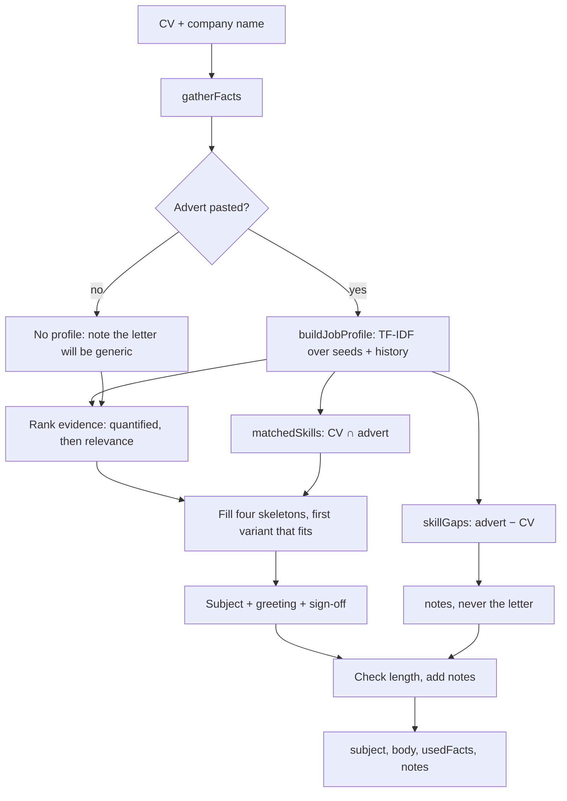

# Algorithms

Supports report section **3.3 Algorithm details**.

Both algorithms below are written from scratch in plain JavaScript in
`server/src/algorithms/`. No NLP, machine-learning or string-similarity library
is used.

They are implemented in **Phase 5**. This file records, for each algorithm:
purpose, formulas, pseudocode, a Mermaid flowchart, and a small worked numeric
example.

---

## 1. CV Strength Score

_To be completed in Phase 5._

Planned structure:

- Purpose, inputs and outputs
- Scoring model: completeness (40 points) and content quality (60 points)
- The weights table taken from `server/src/config/scoringConfig.js`
- Pseudocode
- Flowchart
- Worked example on a sample CV

---

### 1.1 The foundation gate (added after review)

A CV created from the dashboard is not empty: the builder copies the account
name and email into it. Under the criteria alone that earned **13/100** before
the user had typed anything — part of the personal-details mark, half of the
contact-format mark, and the full date-consistency mark, which was awarded for
having no dates to contradict each other.

Two changes fixed it.

1. **Date consistency must be earned.** No dated entry, no marks. A CV cannot
   pass a check it has no data for.
2. **The total is scaled by how much of a CV exists.** Four components make a
   document a CV: a summary, experience or projects, education, and skills.
   Contact details are deliberately excluded — an email address is how someone
   reaches you, not a reason to.

```
present  = number of the four components with content        (0…4)
factor   = minFactor + (1 - minFactor) * (present / 4)        minFactor = 0.1
total    = round(rawScore * factor)
```

The factor rises linearly, so the number still moves as soon as the user does
something, which is the point of showing it live while they type. A CV with all
four components scores exactly as it did before: the gate can only reduce an
unfinished CV.

**Worked example — a newly created CV**

| Criterion         | Earned              |
| ----------------- | ------------------- |
| Personal details  | 4.0 (2 of 4 fields) |
| Valid email/phone | 3.0 (email only)    |
| Everything else   | 0                   |
| **Raw**           | **7.0**             |

`present = 0`, so `factor = 0.1 + 0.9 × 0 = 0.1`, and
`total = round(7.0 × 0.1) = 1`.

A total that rounds to 0 while something was earned is reported as 1, so the
first thing a user types is visible.

### 1.2 Loopholes closed after testing sample CVs

Five sample CVs were scored by hand: a strong one, a list of duties, one whose
only numbers were years, a deliberately padded one, and a strong one with an
undated role. Five rules were giving the wrong answer.

| Problem found                                                                        | Rule now                                                                                                   |
| ------------------------------------------------------------------------------------ | ---------------------------------------------------------------------------------------------------------- |
| "Joined in 2021" counted as a quantified result, so a CV with no results scored 82   | Four-digit numbers from 1950 to 2049 are read as years and do not count. Rs/NPR amounts and lakh/crore do. |
| "Prepared", "Reconciled", "Taught", "Wrote" were not action verbs                    | About 45 common verbs from outside software added, plus irregular past tenses ("wrote", "taught", "sold")  |
| The Classic and ATS templates never print a photo, yet a CV using them lost 3 points | Photo marks are given when the chosen template does not use a photo (`templatesWithoutPhoto`)              |
| One dated entry earned all 6 date marks; a start date in the future was not noticed  | Marks = entries with a start date, a sensible end and no future start ÷ all roles and education entries    |
| A summary of "a a a …" earned the full length marks                                  | If under half the words are different, only the different words count towards the length                   |

Results before → after: strong CV 94 → 100, list of duties 58 → 61, years-only
CV 82 → 71, padded CV 87 → 77, strong CV with one undated role 94 → 98.

**Limit that remains by design.** The score measures structure and writing
habits, not truth or relevance: 40 of the 100 points are for sections being
present, so a CV with every section filled in can still reach the 70s with
weak content. Relevance to a particular job is the match analyser's job
(section 2), not this score's.

---

## 2. CV–Job Match Analyser (ATS simulation)

_To be completed in Phase 5._

Planned structure:

- Purpose, inputs and outputs
- Step 1 — text preprocessing: normalisation of protected technical terms
  before punctuation removal, tokenising, stop-word removal, a
  suffix-stripping stemmer, and bigrams for multi-word skills
- Step 2 — TF-IDF, using smoothed IDF so weights never fall to zero on a small
  corpus:

  ```
  tf(t, d)  = count(t in d) / totalTerms(d)
  idf(t)    = ln((1 + N) / (1 + df(t))) + 1
  w(t, d)   = tf(t, d) * idf(t)
  ```

- Step 3 — cosine similarity between the CV vector and the job description
  vector:

  ```
  cos(A, B) = (A . B) / (||A|| * ||B||)
  ```

- Step 4 — keyword gap analysis over the top-N weighted job description terms
- Step 5 — skill coverage against `server/src/data/skillsDictionary.js`
- Step 6 — overall weighted match score, and the reasoning behind the weights
- Pseudocode
- Flowchart
- Worked example with a small corpus, showing the numbers at each step

### 2.1 Strictness (added after review)

Three changes, for the same reason as the foundation gate: a score that is
generous by default tells the user nothing.

**Similarity scaling.** The realistic band was widened from 0.05–0.55 to
**0.08–0.62**. Two unrelated documents written in the same language still share
enough ordinary vocabulary to clear 0.05, so the old floor paid out for
nothing; the higher ceiling means full marks require the CV to genuinely read
like the advert.

**A ceiling tied to skill coverage.** The weighted sum alone let a CV that
names none of the advert's tools still reach the mid-forties, because it talks
about the same kind of work in the same kind of language. No screening system
would agree.

```
weighted = (scaledSimilarity * 0.45 + skillCoverage * 0.55) * 100
cap      = 45 + (100 - 45) * skillCoverage
score    = round(min(weighted, cap))
```

The cap only ever lowers a score, and applies only when the advert names skills
the dictionary recognises — a gap in our dictionary must not become the user's
problem.

**Bands.** Each raised by five points: Excellent 85, Strong 70, Moderate 55,
Weak 35.

**Worked example — the same CV against the same advert, two stacks**

| Advert's required skills                    | Coverage | Raw cosine | Score | Band      |
| ------------------------------------------- | -------- | ---------- | ----- | --------- |
| JavaScript, React, Node.js, MongoDB, Docker | 0.90     | 0.53       | 87    | Excellent |
| Python, Django, PostgreSQL, Kubernetes      | 0.62     | 0.44       | 64    | Moderate  |

The prose of the advert barely changed between the two rows, so similarity
stays high; it is coverage, and the cap it sets, that separates them. That is
the behaviour an ATS has and the previous model did not.

### 2.2 What the keyword gap is allowed to say

The gap list is produced **after** the score, from the same vectors, and two
rules shape it. Neither can move a score, and that separation is the point:
if filtering changed the maths, the matcher would be tuning its own marks to
make its advice read better.

**Unactionable words are dropped** (`UNACTIONABLE_WORDS` in `jobMatcher.js`).
These are not stop words — they survive the stop-word list and genuinely
carry TF-IDF weight, because on a small corpus a word appearing in one advert
and no other looks distinctive whatever it means. The list covers words that
describe the vacancy rather than the work (_role_, _candidate_, _salary_),
abstract descriptions of a person (_experience_, _ability_, _strong_),
indefinite people (_someone_, _anyone_, _team_), and **number words** (_four_,
_five_, _ten_). The tokeniser already drops a bare digit, but "four" in "four
years of experience" survives it and then scores well. Before these were
added, the most frequently reported gap across the whole system was the word
_someone_, with _four_ and _five_ close behind — the clearest possible
evidence that a high TF-IDF weight is not the same thing as useful advice.

**Named skills are listed first.** The list is cut to
`MATCH_CONFIG.maxMissingKeywords`, so the order decides what the user is
actually told. Each entry carries `isSkill`, set when the term is in
`skillsDictionary.js`, and the list is sorted on that flag with TF-IDF order
preserved inside each group (`Array.prototype.sort` is stable in Node). "You
do not mention Kubernetes" is worth more to a candidate than "you do not
mention stakeholder", however the weights ranked the two.

Real output for a React CV after both rules, starred where the dictionary
recognised the term:

| Advert             | Missing keywords, in the order shown                            |
| ------------------ | --------------------------------------------------------------- |
| React Developer    | jest\*, typescript\*, tests, component, integration, accessible |
| Accounts Assistant | bookkeeping\*, payroll\*, excel\*, accounts, assistant, finance |

Analyses stored before this change keep the keywords they were saved with, so
the admin's skill-gap report mixes old and new until the older rows age out.

---

## 3. Job-Tailored CV Rewrite

Files: `server/src/algorithms/cvTailor.js`,
`server/src/algorithms/phraseRewriter.js` and
`server/src/algorithms/pageFill.js`.
Weights and thresholds: `TAILOR_CONFIG` in `server/src/config/scoringConfig.js`.

### 3.1 Purpose

Given one CV and one job advert, produce a **draft second CV** aimed at that
advert, together with a list of every change and the reason for it.

**Input:** a CV document, the advert text, and the adverts already analysed in
the system (which join the TF-IDF corpus).
**Output:** `{ draft, changes[], suggestedSkills[], pageFill, notes[] }`.

### 3.2 The constraint that shapes it

There is no language model. A program that cannot write English must not
pretend to, so the rewrite is limited to four operations that are honest
without being creative:

| Operation   | What it does                                                      | Why it is safe                                    |
| ----------- | ----------------------------------------------------------------- | ------------------------------------------------- |
| Re-ordering | Most relevant achievements, projects, skills and sections first   | The same facts, read in a different order         |
| Re-wording  | Promotes the verb the user already wrote to the front of the line | The verb comes from the user's own sentence       |
| Re-spelling | "JS" to "JavaScript" where the advert says "JavaScript"           | Only between aliases of one dictionary entry      |
| Assembling  | Builds a summary from CV facts joined by fixed connecting phrases | Every noun, number and skill is already on the CV |

Where it cannot act honestly it says so instead. A bullet with no verb to
promote, and a role that quantifies nothing, come back in `notes` as advice.
The module will not choose a verb or invent a figure on the user's behalf.
This is the answer to "does it make things up?" in the viva: it has no
generator, so it cannot.

### 3.3 Relevance

One definition is used everywhere: the share of the advert's highest-weighted
TF-IDF vocabulary that a piece of text covers.

```
profile    = top 60 terms of tfidfVector(advert) by weight
total      = sum of their weights

             sum of profile[t] for each DISTINCT term t in text
rel(text) =  --------------------------------------------------
                                 total
```

Distinct terms, not repeated ones. Saying "Node.js" eight times in one bullet
does not make it eight times more relevant — counting it that way would reward
exactly the keyword stuffing the match analyser exists to detect.

The weighting is the same `tfidf.js` the match analyser uses, over the same
corpus, so a change the tailor makes and the score the analyser reports cannot
disagree about what the advert is asking for.

### 3.4 The nine steps

1. **Weight the advert.** Build the relevance profile above, and measure how
   close the CV already is to the advert's field (section 3.8).
2. **Headline.** Set it to the advertised job title — but only where the CV
   supports it. If none of the person's own job titles shares a meaningful
   word with the advert's, their headline is left alone and the user is told
   why. An unguarded headline produced drafts that contradicted themselves on
   their first two lines: headlined "Accountant", opening "React Developer
   with 7+ years". The summary was already guarded this way; the headline was
   not.
3. **Skills.** Split the advert's skills three ways (section 3.5).
4. **Experience.** Re-word each line (section 3.6), re-order each role's
   achievements by relevance, tie-broken by whether the line quantifies
   anything. **Roles themselves are never re-ordered** — a reader judges a
   career by its chronology, and shuffling roles by keyword would make a
   recent job look like an old one.
5. **Projects.** The same re-wording, and the projects _are_ re-ordered,
   because unlike roles they have no expected order.
6. **Summary.** Assemble from CV facts (section 3.7).
7. **Section order.** Sort the movable sections by relevance, within the slots
   they already occupy — `summary` stays at the top and `references` at the
   bottom. A margin of 0.02 stops near-equal sections swapping on noise.
8. **Reach the target score**, as far as the field fit allows (section 3.8).
9. **Fill the page** (section 3.10).

### 3.5 The three kinds of skill

This is the ethical core of the feature.

| Group         | Condition                                             | Action                   |
| ------------- | ----------------------------------------------------- | ------------------------ |
| **Promoted**  | Advert wants it, CV lists it                          | Moved to the front       |
| **Added**     | Advert wants it, CV describes it but does not list it | Added to the skills list |
| **Suggested** | Advert wants it, CV never mentions it                 | **Never added.** Offered |

An "added" skill is one the user has already claimed in their own words
somewhere on the CV; a screening system reads the skills section first, so
moving it there costs nothing and claims nothing new. A "suggested" skill has
no evidence at all, and adding it would be the program putting words in the
user's mouth.

### 3.6 Re-wording a line

```
rewriteAsAction(line):
    opener := the weak opener the line starts with, if any
                ("responsible for", "duties included", "worked on", ...)
    if no opener        -> return unchanged
    verb := gerundToBase(first word after the opener)
    if no gerund there  -> return UNCHANGED, with a reason for the user
    return tidy(tense(verb) + rest of the line)
```

`gerundToBase` strips "-ing", undoes a doubled consonant, then consults
`data/actionVerbs.js`:

| Input      | Strip   | Undouble | Word list says             | Result  |
| ---------- | ------- | -------- | -------------------------- | ------- |
| `testing`  | `test`  | —        | `test` is a verb           | `test`  |
| `planning` | `plann` | `plan`   | `plan` is a verb           | `plan`  |
| `writing`  | `writ`  | —        | `writ` is not, `write` is  | `write` |
| `editing`  | `edit`  | —        | `edit` is a verb, leave it | `edit`  |
| `sitting`  | `sitt`  | `sit`    | undoubled, so never `site` | `sit`   |

The word list is what makes this reliable without a table of irregular
gerunds: a spelling rule alone turns `writ` into `write` _and_ `edit` into
`edite`, and nothing but a dictionary can tell those two apart.

Re-spelling then runs over the result. Its boundary rule needs two conditions
on each side rather than one, because skill names contain the punctuation that
would otherwise end a word: the obvious "not next to a letter or digit" rule
matches `node` inside `Node.js` (giving `Node.js.js`) and `js` inside `Vue.js`
(giving `Vue.JavaScript`). A match joined to more text by `.`, `+` or `#` is
therefore refused.

#### 3.6.1 Clean-up and tense (added to improve writing quality)

Each sentence of a description is now polished on its own
(`splitSentences` splits on ". " followed by a capital), through three steps
in `polishSentence`. None of them adds a fact, number, skill or verb — each
only removes words or changes a verb's tense.

```
polishSentence(line, present):
    1. rewriteAsAction       "Responsible for managing X" -> "Managed X"
    2. removeFiller          filler words first, then a leading "I"/"We"
                             before a verb
    3. normaliseTense        only if step 1 changed nothing
```

| Rule                        | Before                                    | After                        |
| --------------------------- | ----------------------------------------- | ---------------------------- |
| Leading pronoun             | I conducted API testing                   | Conducted API testing        |
| "was able to" + user's verb | Was able to reduce costs by 20%           | Reduced costs by 20%         |
| Filler words                | Successfully built…, in order to, utilise | Built…, to, use              |
| Gerund, finished role       | Performing automation testing             | Performed automation testing |
| Gerund, current role        | Performing automation testing             | Perform automation testing   |
| Third-person, finished role | Leads the QA team                         | Led the QA team              |
| Noun phrase (left alone)    | Testing of payment flows                  | _unchanged_                  |

A bare base form ("Test cases for login") is never converted, because too many
of them are also nouns. A first word followed by "of", "is", "were", "and"…
is treated as a noun and left alone.

### 3.7 Assembling the summary

Five sentences, each from a named source, added until the word budget runs
out. The first two are never dropped.

| #   | Sentence                                                        | Source                                                                |
| --- | --------------------------------------------------------------- | --------------------------------------------------------------------- |
| 1   | "Backend Developer with 3+ years of hands-on experience."       | Advert's job title (softened, below); dates on the experience section |
| 2   | "Core skills include Node.js, Express and Docker."              | Skills, the advert's ones first                                       |
| 3   | "Notable result: cut API response time by 40%."                 | The first achievement containing a number, cleaned up, then quoted    |
| 4   | "Holds a BCA in Computer Applications from TU."                 | The first education entry                                             |
| 5   | "Looking to bring these strengths to a Backend Developer role." | Advert's job title, as advertised                                     |

**Varied phrasing.** Sentences 1, 2, 3 and 5 each have three interchangeable
phrasings. One is picked with a string hash of the person's name
(`hash = (hash × 31 + charCode) mod 1000003`), offset per sentence, so two
people's summaries read differently but one CV gets the same summary on every
rewrite — deterministic, so it can be tested.

**Seniority guard (`softenTitle`).** The headline and sentence 1 use the
advert's title minus any seniority word (senior, lead, principal, head, …)
that no title on the CV already contains. "Senior QA Engineer" becomes "QA
Engineer" for a candidate with no senior role; the closing sentence still names
the advertised role, because that is what they are applying for.

**Years of experience** count the **months actually worked**: each role becomes
a [start, end] range, overlapping ranges are merged, and the merged ranges are
added. Two overlapping three-year jobs are three years, not six, and a gap
between jobs is not counted — overstating a career is the one thing a generated
summary must never do.

If the CV does not hold enough to reach the 30-word minimum, a short summary
is returned and `notes` says so. It is never padded with filler.

### 3.8 Reaching the target score, and the limits on it

File: `reachTarget` and `fieldFit` in `cvTailor.js`. Numbers: `TAILOR_CONFIG`.

Steps 2 to 7 only move material the CV already contains, so they are safe
against any advert: the worst they can do is find nothing to do. The rewrite
also aims for a **target match of 80%**, and on a CV the honest steps leave
short of it there are only two levers left, both of which write something the
CV does not say:

1. **Assume a skill.** Add one of the advert's skills that the CV never
   mentions. Added one at a time, re-scoring after each, stopping the instant
   the target is reached.
2. **Mirror the advert's language.** Append one clearly-labelled sentence to
   the summary — `Focus for this role: …` — listing the advert's own words for
   the work that the CV never uses. Terms are added in batches of 3,
   re-scoring after each batch.

**Why the levers need a limit.** Left ungoverned they behaved backwards: the
_less_ a CV had to do with an advert, the _more_ they had to invent to reach
80%, so the worst-matched CVs got the most fabrication. Measured across a
spread of CVs and adverts, a React developer's CV against an accounting advert
went from a true 0% to a reported 69% — headlined "Accountant", with three
accounting skills assumed and twelve accounting words pasted into a summary
that still opened "React Developer". A target that can be reached from any
starting point measures nothing.

**Field fit.** So how far the pass may go is scaled by how close the CV
already is. The distance is the share of the advert's weighted vocabulary that
the CV's **evidence** already covers:

```
overlap = rel(evidenceText(cv), profile)

evidenceText = experience + projects + education + certifications
             + skills that a previous rewrite did not assume
```

The summary is deliberately excluded, for two reasons. It is what someone
_says_ about themselves, where roles and qualifications are what has to be
true; and the rewrite writes it, in the advert's language by design, so
judging the field from it let one pass's output become the next pass's
evidence.

| Level         | Overlap                                | Assumed skills | Focus terms |
| ------------- | -------------------------------------- | -------------- | ----------- |
| **same**      | ≥ 0.25                                 | up to 6        | up to 12    |
| **adjacent**  | ≥ 0.05, or the job titles share a word | up to 3        | up to 6     |
| **different** | below that                             | **none**       | **none**    |

The thresholds are measured, not guessed. Over 18 CV–advert pairs whose
relationship was labelled in advance, unrelated pairs sat at 0.00–0.03,
neighbouring ones at 0.06–0.22 and same-field ones at 0.29–0.59, and all 18
classify correctly at 0.05 and 0.25.

On a `different` advert the pass does nothing at all, and the user is told
plainly that the advert is from another field and what would change that
(describing the work in a role or a project).

**Two scores, not one.** `tailorCV` returns `honestScore` — what the draft
reached on steps 2 to 7 alone, before anything was assumed — alongside
`matchScore`. The review screen shows both, so the user can see what the
assumptions are worth before being asked to confirm or delete them. Deleting
them lowers the score, and it should.

**Assumed skills are marked.** Each one is saved as `skills[].assumed = true`.
Without the flag, the one part of a tailored CV that the CV does not support
became indistinguishable from the rest the moment it was saved, and tailoring
an already-tailored CV ratcheted: each pass read the last pass's assumptions
as evidence and awarded itself a fresh allowance. The flag closes both — the
ceiling counts skills already marked, and `fieldFit` ignores them. A draft
tailored repeatedly against the same advert now settles after one pass instead
of climbing.

### 3.9 Worked example

**CV (extract)**

```
Headline:    Junior Developer
Skills:      PHP, Node.js
Experience:  Developer, Acme, 2021-01 to 2024-06
             "Responsible for building REST APIs in Node.js with Express."
             - "Mentored two interns"
             - "Cut API response time by 40% with caching"
Projects:    Recipe blog (PHP), API gateway (Express, Docker)
```

**Advert:** _Backend Developer — build REST APIs with Node.js, Express and
MongoDB. Docker and AWS essential. Write unit tests, work in an agile team._

**Result**

| Step                 | Change                                                                          |
| -------------------- | ------------------------------------------------------------------------------- |
| Headline             | Junior Developer to **Backend Developer**                                       |
| Skills — promoted    | Node.js moved to the front                                                      |
| Skills — added       | **Express**, **Docker** (described in the role and the project)                 |
| Skills — suggested   | MongoDB, AWS — _not added_, offered to the user                                 |
| Experience — wording | "Responsible for building..." to **"Built REST APIs in Node.js with Express."** |
| Experience — order   | The 40% achievement moved above "Mentored two interns"                          |
| Experience — note    | The shop role quantifies nothing; the user is told, not given a figure          |
| Projects             | API gateway moved above Recipe blog                                             |
| Summary              | "A developer." to the five sentences of section 3.7                             |
| Sections             | skills and projects promoted above education                                    |
| Field fit            | **same** (overlap 0.33) — the full target-pass allowance                        |
| Target pass          | MongoDB, AWS and Agile assumed; 3 focus terms added                             |
| Scores               | 0% untailored → **45% honest** → 82% with the assumptions                       |

The headline moves here because this CV supports it: "Junior Developer" and
"Developer" share a word with "Backend Developer". The same advert against the
shop CV of section 3.8 leaves the headline as "Sales Assistant", assumes
nothing, and reports the shortfall.

The controller runs `analyseMatch` over the original and over the draft and
returns both scores, plus the honest score, so the user can see whether the
rewrite actually helped — and how much of the help they would keep after
deleting the assumptions — rather than taking it on trust.

### 3.10 Filling the page

File: `server/src/algorithms/pageFill.js`. Numbers: `PAGE_FILL_CONFIG`.

A tailored CV that stops half way down the page looks unfinished whatever it
says, and the eight steps above had no way of noticing. This one measures the
draft against an A4 page and, when it falls short, pulls the levers it
legitimately has.

**The measurement.** The server cannot see the browser lay the page out, and
rendering one through Puppeteer on every rewrite would be absurd, so the
height is estimated in lines of text:

```
capacity(settings) = usableHeightMm / (fontSizePt × 0.3528 × lineHeight)
                   = 257 / (10.5 × 0.3528 × 1.45)  ≈  47.8 lines at medium

lines(cv) = Σ sectionLines(section)       for a one-column template
          = max(mainColumn, sideColumn)   for modern and executive
```

The two-column case is not a detail. A sidebar of skills sits _beside_ the
experience, not under it, so summing every section would report a page as
nearly full while half the main column is white space — which is precisely the
situation being looked for. `sideColumns` in the config mirrors
`SIDEBAR_SECTIONS` in `ModernTemplate.jsx` and `RAIL_SECTIONS` in
`ExecutiveTemplate.jsx`.

A CV counts as full at 90% of the page rather than 100%: a page that ends
exactly on the bottom margin is one word away from spilling onto a second, and
the user is about to edit it.

**The levers**, applied in order and stopping the moment the page is full —
content first, then presentation:

| #   | Lever                                                            | What it costs the reader                                 |
| --- | ---------------------------------------------------------------- | -------------------------------------------------------- |
| 1   | Show sections hidden in the settings that have content           | Nothing — it was their content                           |
| 2   | Let the summary run to 110 words and name 10 skills instead of 6 | Nothing — every sentence was already sourced from the CV |
| 3   | Step the font size up towards `large`                            | Nothing — the same words, more page                      |

Lever 2 is worth being precise about. `buildSummary` normally stops at the
word count the strength scorer rewards; raising the ceiling does not make it
write anything new, it only stops it holding back sentences it had already
assembled from the user's qualification, skills and quantified achievement.

**What it will not do** is write experience the user does not have. That is
the line the whole module is built around, and a blank half page is not a good
enough reason to cross it: the employer would be deceived and the candidate is
the one who has to defend it at interview. Where the levers run out, the step
reports the shortfall and names the most useful thing the user could add — two
more bullet points under a thin role, a projects section, a certification —
chosen from what is actually missing rather than as generic advice.

In practice a one-role CV in the Modern template goes from about 48% of a page
to about 61%. The remaining gap is content, and only the user has it.

## 4. Cover Letter Composer

Files: `server/src/algorithms/coverLetterComposer.js`.
Wording and thresholds: `server/src/config/coverLetterConfig.js`.

### 4.1 Purpose

Given one CV, a company name and optionally a job advert, produce a **cover
letter** that could be read by that employer, together with the facts it drew
on and a list of what it could not evidence.

**Input:** a CV document, `{ companyName, jobTitle?, jobDescription?,
recipientName? }`, and the adverts already analysed in the system (which join
the TF-IDF corpus).
**Output:** `{ subject, body, usedFacts, notes[] }`.

### 4.2 The constraint, again

The same rule as the rewrite, and for the same reason: there is no language
model, so the module must not appear to write English of its own. Every
sentence in the finished letter is one of exactly two things:

1. a fact copied out of the CV, or
2. a fixed connective from `coverLetterConfig.js`.

There is no third category. A reader asking "which words did the program
choose?" in the viva can be shown the config file in full — it is the complete
vocabulary of the module.

Where a fact is missing, the sentence that needed it is **dropped** and a note
is returned saying so. The composer never fills a gap. That is why several
skeletons come in pairs:

| Skeleton            | Used when                             | Falls back to                            |
| ------------------- | ------------------------------------- | ---------------------------------------- |
| `opening.withTitle` | A job title was given                 | `withoutTitle` — interest in the company |
| `opening.standing`  | The CV has a headline and dated roles | `standingNoYears`, then nothing          |
| `evidence.lead`     | There is a most-recent employer       | `leadNoEmployer`, then `projectLead`     |
| `fit.withAdvert`    | CV skills and advert skills overlap   | `withoutAdvert` — the strongest skills   |

The rule is "first variant whose placeholders can all be filled", implemented
by `fill()` returning `null` the moment any placeholder is empty.

### 4.3 The five steps

```
composeCoverLetter(cv, { companyName, jobTitle, jobDescription, recipientName }):
  1. facts   <- gatherFacts(cv)
  2. profile <- jobDescription ? buildJobProfile(jobDescription, corpus) : null
  3. paragraphs:
       opening  <- fill(opening skeleton, { jobTitle, company, headline, years })
       evidence <- rank candidate lines, take top 2, phrase as "I <clause>"
       fit      <- matched skills, or strongest skills when no advert
       close    <- standard, or brief when the letter already runs long
  4. subject  <- first subject skeleton that fits
     body     <- greeting + paragraphs + sign-off + name
  5. notes    <- everything that could not be evidenced
  return { subject, body, usedFacts, notes }
```

Steps 1 and 2 reuse modules that already exist rather than reimplementing
them: `yearsOfExperience`, `buildJobProfile` and `relevanceOf` from
`cvTailor.js`, `hasQuantifiedResult` from `cvStrengthScorer.js`,
`polishSentence` from `phraseRewriter.js`, and `findSkills` from the skills
dictionary. The composer adds the letter structure and nothing else.

### 4.4 Which evidence leads

Candidate lines are the achievements of the most recent role, followed by the
sentences of its description, filtered to those between 25 and 320 characters.
They are then ordered:

```
sort by:  quantified (a number present)   descending
then:     relevance to the advert          descending
then:     the user's own order             ascending
```

**Quantified wins outright, before relevance.** This was changed during
development: ranking by relevance first produced letters that led with a
restated job description — a line stuffed with the advert's vocabulary but
saying nothing — while the "cut fulfilment time by 35%" bullet fell to third
and was cut. A number is the one claim in a cover letter a reader cannot
argue with, and no amount of vocabulary overlap outweighs it.

### 4.5 What it will not claim

`matchedSkills` returns only skills that appear in **both** the CV and the
advert, reported in the CV's spelling because that is the user's own word for
it. `skillGaps` returns the opposite — skills the advert asks for that the CV
does not list — and that list **never enters the letter**. It is returned in
`notes` as advice:

> The advert also asks for Python, which your CV does not list. If you have
> that experience, add it to your Skills section — the letter will not claim
> it for you.

This is the single most important line in the module. The temptation in a
cover letter generator is to write the skill the employer asked for; doing so
would make the application a lie that the candidate has to defend at
interview.

### 4.6 Worked example

A CV with one current role at Himalaya Logistics, a headline of "Operations
Manager", four years of dated experience, the skills Excel (Expert), SQL
(Advanced), Logistics and Power BI, and the achievement "Cut average
fulfilment time by 35% across three regional sites". The advert asks for
Excel, SQL and Python.

| Step | Result                                                                                                                                                          |
| ---- | --------------------------------------------------------------------------------------------------------------------------------------------------------------- |
| 1    | `years = 4`, skills ordered Excel, SQL, Logistics, Power BI                                                                                                     |
| 2    | Advert profile built; Python detected as asked for                                                                                                              |
| 3a   | Opening: title and company fit → "apply for the Operations Manager position at Sagarmatha Supply", plus "I am an Operations Manager with 4 years of experience" |
| 3b   | Evidence: the 35% line is quantified so it leads; the description sentence follows                                                                              |
| 3c   | Fit: Excel and SQL overlap → `withAdvert`; Power BI is dropped as it is not asked for                                                                           |
| 3d   | Close: standard, the letter is not yet long                                                                                                                     |
| 4    | Subject: "Application for Operations Manager — Rijan Pariyar"                                                                                                   |
| 5    | Notes: the Python gap; the letter is shorter than typical                                                                                                       |

Produced letter:

```
Dear Hiring Manager,

I am writing to apply for the Operations Manager position at Sagarmatha
Supply. I am an Operations Manager with 4 years of experience.

In my most recent role as Operations Manager at Himalaya Logistics, I cut
average fulfilment time by 35% across three regional sites. I also ran the
fulfilment desk across three sites.

The advert calls for Excel and SQL, and these are areas I work in directly.

I would welcome the chance to discuss how my experience could support your
team. My CV is attached, and I am happy to supply any further detail you need.

Kind regards,
Rijan Pariyar
```

Every noun in it — the employer, the role, the figure, the skills, the name —
is on the CV. Every other word is in the config file.

### 4.7 Flowchart


